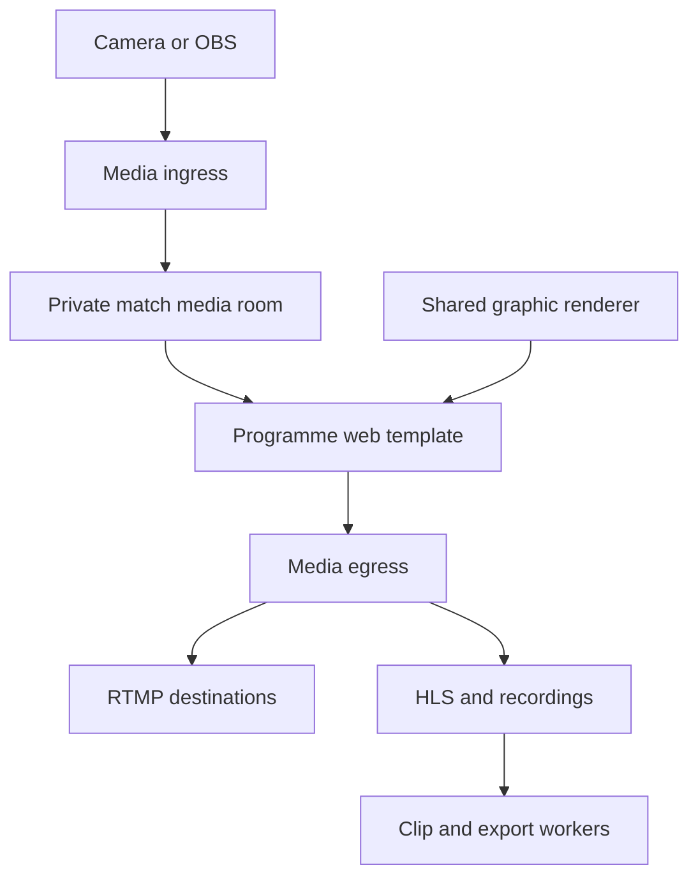
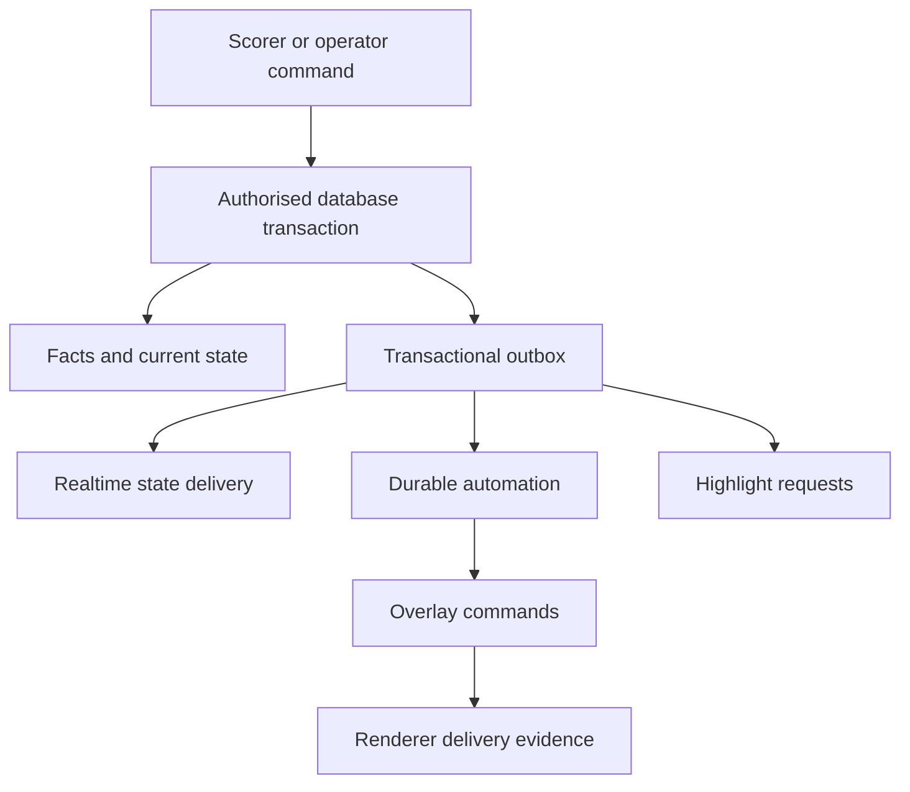

# Broadcast Studio — full MVP specification for Claude Code

Prepared for Kai Brown · 19 October 2026 · Version 1.0

**Deliverable:** an implementation brief for a working LIGR-style sports broadcast web application. This file is a specification, not an already implemented application.

**Working product name:** Broadcast Studio. Keep the name, logo, colours and domain configurable. Use original UI components, graphics and sample assets.

## 1. Start here: instruction to Claude Code

Put this file in the project root as `MVP_SPEC.md`, open Claude Code in that directory, and give it the following instruction:

```text
Read MVP_SPEC.md completely and implement its P0 release as a working application.

First inspect the existing repository, package versions, AGENTS.md/CLAUDE.md,
architecture, environment and uncommitted changes. Preserve existing work.
If the repository is empty, initialise the monorepo specified in this document.

Use this document as the product requirements, architecture and acceptance
contract. Create IMPLEMENTATION_PLAN.md and a concise CLAUDE.md identifying the
specification, development commands, invariants and current milestone.

Begin with Milestone 0: prove the actual video pipeline. Then implement the
remaining milestones in order, delivering tested vertical slices. Build all P0
requirements; keep P1 requirements in a visible backlog. A milestone is a build
sequence, not permission to stop the overall assignment early.

Do not replace cloud compositing, persistent data, scoring, automation, exports
or authentication with visual simulations. Fixtures and mocked adapters are
allowed in tests and explicitly labelled demo mode. The default local media
profile must process real video without paid vendor credentials.

Make routine implementation decisions and continue. Ask only when an essential
secret, external account, consequential scope choice or unavailable environment
prevents further progress; continue independent work meanwhile. Record an exact
blocker and reproduction steps when an environment prevents verification.

Use current official documentation and compatible pinned package/container
versions. Do not mix examples from incompatible SDK generations. In particular,
check the installed LiveKit server, SDK, Ingress and Egress versions together.

Run the meaningful unit, database, end-to-end and media checks defined here.
Maintain requirement IDs and evidence in ACCEPTANCE_RESULTS.md. Never label an
unexecuted check passed or a configured integration as proven operational.

Finish with working source, migrations, demo seed, Docker Compose, .env.example,
setup/runbook documentation, automated checks and an honest completion report.
Do not stop at a design, dashboard, static prototype, scaffold or mock buttons.
```

### Binding interpretation

“Same as LIGR” means the same essential user outcomes: prepare competitions and fixtures, score matches, operate professional graphics, automate a broadcast, deliver sponsors, stream, record and create highlights. This specification defines an independent implementation of those workflows.

The public materials expose features and examples, not LIGR's private code, internal architecture or every authenticated screen. Requirements below are **proposed engineering decisions** unless explicitly described as a public reference. Do not represent an inferred workflow as an observed private feature.

P0 is the complete first usable release. P1 is the explicit path to broader product parity. Do not claim complete commercial-product parity when only P0 is delivered.

## 2. Product outcome and scope

An organisation can run multiple sports broadcasts from its browser. A scorer enters a match event once; accepted match data updates the scoreboard, drives an automatic graphic sequence, selects an eligible sponsor, and creates a highlight request against the correct recording.

Two independent output paths must work:

1. **Graphics only:** a transparent production URL loaded into an OBS/vMix browser source, with the operator controlling graphics remotely.
2. **Cloud programme:** a camera/encoder sends real video to the media service; the platform composites the same graphics into that video, distributes it to configured destinations, records it and makes clips.

Neither path depends on the operator keeping the control-room tab open.

### 2.1 Public reference map and implementation boundaries

These are brief summaries of public documentation, followed by our proposed scope. Source links are in section 28.

| Product area | Publicly documented reference | Required P0 implementation | P1 extension |
| --- | --- | --- | --- |
| Match operations | Match table, fixture CSV import, scorer and stream/overlay status [L1] | Competition/season/fixture management, validated imports and operational statuses | Tournament/bracket formats and richer scheduling |
| Live scoring | Browser scoring, restricted scorer access and offline sync [L2] | Football and basketball scoring, history, corrections and an offline outbox | Additional sport adapters and licensed live-data feeds |
| Graphics | Broadcast graphics, configurable themes and competition-level reuse [L3, L4] | Three original themes; scorebugs, lineups, events, lower thirds, stats and full-frame slates | Larger theme marketplace and advanced motion design |
| Graphics output | Match overlays and production links [L5] | Independent overlay instances, transparent browser URLs and safe token rotation | More output languages and territory variants |
| Automation | Playlists, triggers, guards and priorities [L6, L7] | Phase/event/time/milestone triggers, durable execution, rehearsal and manual override | More complex conditional branching |
| Sponsors | Ad sets, allocations, embedded/detached placements and reports [L8] | Campaigns, creative slots, weighted delivery, event sponsorship and verified render logs | Club-sold inventory workflows and advanced commercial reporting |
| Streaming | Cloud composition, RTMP/SRT, destinations and monitoring [L9] | RTMP input, programme/clean outputs, HLS monitoring, up to three RTMP destinations per output | Native SRT gateway, programme WebRTC preview, adaptive bitrate and independent regional feeds |
| Recordings/highlights | Event clips, manual moments, trimming and reusable content [L10] | Live event clips, recording library, trim/crop, branded exports and simple compilations | Advanced editing, social publishing and automatic weekly compilations |
| Storage | Recordings and asset management with access controls [L11] | Private object storage, quotas, retention, safe deletion and signed delivery | Archive tiers and partner content portals |
| Custom graphics | FUSE imports Rive designs, binds data and exposes operator controls [L12] | A constrained template editor with typed data bindings | Rive import/runtime integration, richer expressions and external-data authoring |
| Commercial operation | Public product describes modular services [L13] | Feature entitlements, measured usage and admin-assigned plans | Stripe subscriptions, purchases, tax and invoices |

**Known P0 gaps:** no claim of support for all LIGR sports, exact theme reproduction, a full FUSE equivalent, premium data-provider agreements, an enterprise managed service, unlimited simultaneous broadcasts or all platform publishing APIs.

### 2.2 P0 launch limits

Make these configuration values, enforced on the server:

| Item | Initial release target |
| --- | --- |
| Sports | Football/soccer and basketball, each fully usable |
| Organisations | Multiple isolated organisations |
| Broadcast capacity | Demonstrate two simultaneous 720p programmes on measured reference infrastructure |
| Streams per match | One programme and an optional clean programme |
| RTMP destinations | Maximum three per output |
| Cloud video presets | 1280×720 at 25/30 fps; 1920×1080 at 25/30 fps only after measurement |
| Graphics canvas | 1920×1080 logical coordinates, scaled without changing placement |
| Live preview | Actual programme HLS; input WebRTC; labelled local graphics preview |
| Clip formats | 16:9, 9:16 and 1:1, with manual crop position |
| Default locale | en-AU; Australia/Brisbane; dates stored in UTC |
| Billing | Usage ledger and entitlements; no payment required for a self-hosted installation |

These are product targets, not guaranteed performance before tests. Report measured capacity and disable presets that do not meet the acceptance criteria.

### 2.3 Explicitly outside P0

Native phone apps; AI camera tracking; computer-vision scoring; optical scoreboard reading; a multi-camera vision mixer; instant-replay hardware control; NDI/SDI/ST 2110; 4K/50/60 fps; DRM; a full video NLE; viewer paywalls; a social network; betting feeds; and federation-certified competition management.

The main input is an already selected camera or mixed programme from an encoder such as OBS. This product's control room operates broadcast graphics, data and distribution. Video switching is a separate future module.

## 3. End-to-end launch demonstration

Use synthetic clubs and players, with no copied customer data or logos.

1. An owner registers, verifies their email and creates an organisation.
2. They create a football competition and season, two clubs/teams, a venue and player rosters.
3. They choose a theme and publish a competition graphics profile and game plan.
4. They upload two sponsor logos and a short sponsor video, create a campaign and allocate placements.
5. They import three fixtures; invalid rows show actionable errors before anything is committed.
6. For one match, they add an input, programme output, optional clean output and an RTMP destination.
7. OBS sends a real test video with audio to the input URL/key.
8. A production overlay URL also works separately as an OBS browser source.
9. A scorer opens the mobile scoring page and starts the first half.
10. A recorded goal updates the authoritative score and live output, runs a scorer graphic and sponsor placement, and queues a highlight.
11. The operator previews a lower third without changing output, takes it to air, switches to Manual, clears it, and safely returns to Auto.
12. The scorer loses connection, records another event, refreshes and sees it still pending. Reconnection synchronises it without a duplicate score or delayed celebration.
13. At full time, the programme ends gracefully after the configured post-game window. Recording finalisation completes.
14. An editor trims a goal clip, chooses a crop, adds intro/outro branding and downloads a valid MP4.
15. A sponsor report lists verified output occurrences and duration, distinguishing render evidence from audience views.
16. A second organisation cannot access any of the first organisation's matches, media, outputs or private credentials.

## 4. Users, roles and permissions

Membership belongs to an organisation. Invitations have a specific role and optional competition, team or match scope. Users can belong to multiple organisations and must explicitly switch context.

| Action | Owner | Admin | Producer | Operator | Scorer | Club manager | Viewer |
| --- | --- | --- | --- | --- | --- | --- | --- |
| Ownership, organisation deletion, plans | Yes | No | No | No | No | No | No |
| Members and broad settings | Yes | Yes | No | No | No | No | No |
| Competitions, rosters and fixtures | Yes | Yes | Yes | Read assigned | Read assigned | Own team assets | Read assigned |
| Themes, templates and game plans | Yes | Yes | Yes | Use published | No | No | Read assigned |
| Stream credentials and destinations | Yes | Yes | Yes | Assigned outputs | No | No | No |
| Operate graphics | Yes | Yes | Yes | Assigned matches | No | No | No |
| Score and correct matches | Yes | Yes | Yes | Only if separately assigned | Assigned matches | No | No |
| Sponsor campaigns | Yes | Yes | Yes | Trigger approved placements | No | Own approved assets | Report access if granted |
| Edit/export recordings and clips | Yes | Yes | Yes | If granted | No | Own team, if enabled | Read if granted |
| Audit log | Yes | Yes | Read production records | Own actions | Own match history | Own assets | No |

Enforce permissions in HTTP handlers, realtime subscriptions, workers, object-storage access and exported reports. Hiding navigation is not authorisation. A scorer-only account lands on its assigned scoring list and cannot browse the admin app.

Use a database-backed scorer lease to identify the primary scorer. A producer can take over with an audit reason. Never silently allow two scorers to overwrite clock or period state. Revoking membership invalidates active sessions and realtime access promptly.

## 5. Application navigation and screens

### 5.1 Navigation

Desktop sidebar: Dashboard; Competitions; Matches; Control Rooms; Streams; Assets; Themes; Automation; Sponsors; Media; Reports; Settings.

Top bar: organisation switcher, global search, current date/timezone, notifications, connection status and account menu. Permissions determine visible entries. Breadcrumbs preserve competition, season and match context.

### 5.2 Required routes and contents

Use these URLs or an equivalent consistent hierarchy. Entity IDs are opaque IDs, not authorisation credentials.

| Route | Required behaviour |
| --- | --- |
| `/` | Concise original product page with login and create-account links |
| `/login`, `/register`, `/verify-email`, `/reset-password` | Complete authentication and recovery states |
| `/onboarding` | Organisation → competition → teams → theme → first match; progress is saved |
| `/app` | Live matches, upcoming fixtures, unhealthy streams, usage and quick actions |
| `/app/competitions` | Searchable competition cards/table, sport, season, status and counts |
| `/app/competitions/:id` | Details, seasons, teams, fixtures, theme profile, game plan, output defaults and sponsors |
| `/app/matches` | Date/sport/competition/status filters; expandable streams/overlays; CSV import |
| `/app/matches/:id` | Overview, lineup, facts, scoring, overlays, streams, recordings and highlights |
| `/app/control-rooms` | Reusable section layouts and published template controls |
| `/app/matches/:id/control/:overlayId` | Live production desk described below |
| `/score` | Mobile list restricted to assigned matches |
| `/score/:matchId` | Touch-first score, clock, event buttons, period controls and history |
| `/app/streams` | Actual input/programme health, list/grid, filters and destination details |
| `/app/assets` | Clubs, teams, players, venues, images, videos, audio and brand assets |
| `/app/themes` | Original theme library, profiles, designer and version history |
| `/app/automation` | Game plans, timeline editor, published versions and rehearsal |
| `/app/sponsors` | Brands, campaigns, creative sets, allocations and placement rules |
| `/app/media` | Recordings, highlights, compilations and uploads; processing states |
| `/app/media/:id/edit` | Video preview, range trim, crop, branding and export |
| `/app/reports` | Sponsor delivery, operational usage and CSV export |
| `/app/settings` | Organisation, members, entitlements, quotas, integrations, API keys and audit |
| `/overlay/:publicId` | Isolated transparent renderer using a scoped output capability |
| `/watch/:shareId`, `/embed/:shareId` | Explicitly shared video only; revoke and expiry support |
| `/render/programme` | Internal egress template; no administration shell or public browsing |

### 5.3 Match table

Show kickoff time in selected timezone, competition/season/round, venue, teams, score, match phase, scorer, input status, programme status, destination failures, overlay mode and quick actions. Expand a row for each output and overlay, with Configure, Control Room, Preview, Copy production URL, Recordings and Highlights.

Offer table and compact card views. Persist filters per user. Include sensible loading, empty, unauthorised, archived and error states. Use server pagination and sort for large schedules.

### 5.4 Control-room layout

At 1440 px and wider:

- Header: fixture identity, output selector, Auto/Manual, transport health, production URL, rehearsal/live state and emergency clear.
- Left column, approximately 280–340 px: score, period, clock, permitted quick facts and a searchable event log.
- Middle: a graphic catalogue grouped into Scorebug, Match, Teams, Events, Stats, People, Sponsors and Media. Each card shows thumbnail, required variables and current on-air status.
- Right, approximately 35–40%: Preview and actual Programme panels, selected graphic controls, To Air / Out, active layers and automation queue.
- Bottom/drawer: playlist timeline, execution history and diagnostic warnings.

Preview edits are local draft state until an explicit To Air/Update action. Highlight on-air cards with a clear label and border; colour alone is insufficient. A pending command is not shown as acknowledged. Each output has independent graphics state.

At tablet widths, keep the score/transport strip visible and move catalogue/controls into tabs. The mobile scorer is a separate simplified surface with 44 px or larger touch targets. Do not compress the whole production desk onto a phone.

## 6. Design system and interaction requirements

Use an original broadcast-control aesthetic: dark navy surfaces, restrained blue/cyan accents, readable neutral text, compact operational tables and strong status contrast. Provide a light administrative mode if inexpensive; dark production mode is required.

Initial tokens: background `#0B1220`, panel `#131F32`, elevated `#1C2C43`, border `#30415B`, primary `#3EA6FF`, text `#F3F6FB`, muted `#A7B4C8`, live `#FF5263`, warning `#FFCE66`, healthy `#55D99D`. These are our choices, not sampled LIGR values.

Use a locally available licensed sans-serif font and self-host its assets. Avoid unnecessary animation in administration. Broadcast graphics can animate in/out; default transitions should be approximately 180–350 ms and configurable within safe limits.

Every form needs validation, field-level messages, loading, success and recoverable failure. Destructive actions identify the actual affected entity. Avoid generic “Something went wrong” without a safe next action and diagnostic reference.

Keyboard controls: take selected graphic, take selected graphic out, toggle scorebug, focus search and open clear-output confirmation. Make shortcuts configurable, disabled in text fields and independent of scorer actions. Emergency clear must require a deliberate gesture and be available in Auto and Manual.

## 7. Competition, roster and fixture management

### 7.1 Domain hierarchy

Organisation → optional league grouping → competition → season → fixtures. A competition has a sport/rules profile, theme profile and production defaults. A season has its own roster memberships and fixture dates.

Clubs have one or more teams. A team can participate in multiple competitions. A player is an organisation-level person with dated team/season roster memberships, allowing transfers without rewriting historical matches. Match lineups snapshot player names/numbers/photos and team branding for historical consistency.

### 7.2 Fields

- Competition: name, short name, sport, logo, organisation, optional league, rules version, default timezone, theme-profile version, game-plan version, status and output defaults.
- Season: name, start/end dates, active/archive state and competition ID.
- Club/team: full/short names, abbreviation, logos, home/away colours, age/grade labels and optional club relationship.
- Player: display/first/last names, number, position, photo and roster status. Date of birth is optional and private; public graphics use only approved display fields.
- Venue: name, address, timezone and optional input defaults.
- Match: competition, season, external fixture reference, round, home/away teams, venue, scheduled local datetime with timezone, scorer assignment, status and effective production profile.

Archive entities that have production history. Do not cascade-delete completed match facts, recordings or reports when someone removes a team from the current roster.

### 7.3 CSV import

Provide downloadable templates and a dry-run screen. Fixture columns: `external_id, competition, season, round, home_team, away_team, venue, kickoff_local, timezone`.

Require an unambiguous timestamp and IANA timezone. Reject unknown teams, same-team fixtures, unsupported sport, invalid times and duplicate external IDs. Let the user explicitly map existing names. Creating missing teams requires an explicit import option.

Show row number, field and error; allow downloading an error CSV. Commit only after a valid preview, in an idempotent import transaction. Repeating an import updates explicitly matched future fixtures or skips duplicates according to the selected mode; never silently overwrite live/completed matches. Neutralise spreadsheet-formula prefixes in exported untrusted cells.

## 8. Sport rules and live scoring

### 8.1 Common rules engine

Define a typed `SportAdapter` contract containing configuration schema, allowed events, validation, reducer, scoring display, period transitions, graphic capabilities and highlight defaults. The frontend must read capabilities from the adapter rather than scattering football conditionals across components.

Store `sportRulesVersion` on a match. Updating a competition's rules does not change a match that is already running. Sport adapters must be deterministic and independently testable.

### 8.2 Football P0

Support scheduled, ready, pre-match, players entering, about to start, first half, half time, second half, full time, extra-time halves/breaks, shootout, postponed, abandoned and cancelled states, with permitted transition rules.

Events: goal, own goal, penalty scored/missed, yellow card, second yellow, red card, substitution, corner, shot on target, shot off target, save and manually adjusted team statistics. A normal scored penalty adds one goal through one canonical scoring fact. An own goal credits the opposing team's score while preserving the responsible player.

Provide standard 2×45-minute defaults with configurable junior periods. Display stoppage time, period label, running clock and score. Extra time and shootout scores have separate fields; shootout kicks never change the normal match score. Record lineup starters, bench, captain and formation labels without building a tactical analysis system.

Player selection is optional for an urgent goal: the score may update immediately and the scorer name can be completed afterwards. Do not invent a player. The event graphic falls back to the team name.

### 8.3 Basketball P0

Support configurable 4-quarter and 2-half formats, countdown period clock, overtime, 1/2/3-point scoring, player/team fouls, timeouts, possession indicator and shot clock. Include substitutions and player selection.

Make period length, overtime length, shot-clock values, timeout counts, foul limits and reset behaviour editable rule settings. A default community/FIBA-style profile is a convenience preset; describe the selected rules in the UI rather than claiming official certification. A score event must specify points and whether a shot-clock reset is requested; timeout/foul actions must not unexpectedly change the main clock.

### 8.4 Clock model

The server owns clock state. Store direction, accumulated/base elapsed milliseconds, period ID, anchor timestamp, running/paused flag and version. Clients interpolate from the last anchor using a measured server-time offset and monotonic local elapsed time. Persist only actual clock actions; never write one database row per displayed second.

For an up clock: `displayMs = baseMs + max(0, serverNowMs - anchorMs)` while running. For a down clock: subtract that delta and clamp at zero. Period offsets and football stoppage-time formatting belong to the adapter. A background tab, refresh, reconnect or server restart must not reset the clock.

Permit start, pause, resume and a reasoned correction. Period end is an explicit scoring action in P0; reaching zero raises an alert and clamps display but does not infer an official whistle. Pausing the clock freezes match-clock triggers. Wall-clock scheduling remains distinct.

### 8.5 Facts, corrections and scorer ownership

Persist accepted match facts and all correction records. Each has an ID, match ID, sport event type, team/player references, period/clock position, occurrence time, server acceptance time, source, actor, device and sequence. The server supplies acceptance times, actor and organisation.

An undo creates a void/correction linked to the original fact. It must not delete the original audit entry. Recompute affected score/stat projections, invalidate unrendered automation derived from the fact, and flag any already-made clip as stale. A correction does not replay the original celebration. Audit a direct score correction as an explicit adjustment with a reason.

Use a short renewable scorer lease with a fencing version. Reads continue if it expires; live writes require current authority. Producer takeover displays who took over and prevents the previous session from continuing to modify current clock/period state.

### 8.6 Offline behaviour

Use a service worker for the scorer shell and IndexedDB for cached assigned fixtures and pending command intents. Show Offline, pending count and which values are provisional. Offline operation cannot update a remote live output; say so plainly in the scoring status.

Persist an intent before showing it as queued. Keep its UUID/idempotency key stable across retries and refreshes. On reconnection, load authoritative state, renew/reconcile scorer authority and compare pending intents. Independent facts can be reviewed/rebased against a matching period and roster; clock changes, score overrides, period changes and conflicting scorer activity require explicit resolution. Never apply a stale full-state snapshot over newer server state.

Late facts update the record after acceptance. Historical facts outside the live-trigger window must not run a stack of old on-air graphics or ads. They may generate correctly aligned clips when media exists. A rejected intent stays visible with a reason and a retry/discard workflow.

## 9. Graphics and overlay outputs

### 9.1 Required graphic catalogue

Each template declares supported sports, typed variables, defaults, required data, occupied layers, entrance/hold/exit durations, safe bounds and sponsor slots.

| Graphic | Required variables/behaviour |
| --- | --- |
| Scorebug | Team abbreviations/logos, score, period, clock, optional sponsor slot; basketball fouls/possession/shot clock |
| Match ident | Teams, competition, venue, date, optional kickoff countdown |
| Team lineup | Starters and substitutes; paginate or split overflow predictably |
| Goal/score event | Team, player if available, event time and updated score |
| Card | Card type, team, player fallback and event time |
| Substitution | Team, player out/in, numbers and event time |
| Lower third | Heading, subtitle and optional image, with length limits |
| Player card | Selected player, photo/placeholder, number and supported stats |
| Match statistics | Configured stat rows, units and missing-data state |
| Break/final score | Phase, score, competition and optional sponsor |
| Sponsor graphic | Approved logo/banner, campaign association and expiry |
| Full-frame media | Image or normalised video, fit/crop, playback and audio policy |
| Ticker | Sanitised plain text with speed and maximum-length limits |
| Holding slate | Waiting for input, pre-game, interval and end-of-broadcast messages |

Provide three complete original themes: Minimal, Broadcast and Club. Each must implement the applicable catalogue; a different colour palette alone does not constitute a third theme. Supply original thumbnails and working live-data previews.

### 9.2 Rendering contract

Build one shared graphics package for production overlay, local preview, rehearsal and cloud template. Render from an explicit state snapshot with immutable theme/template versions. Use a 1920×1080 logical stage, aspect-preserving scaling and a configurable title-safe region, initially 5% from each edge.

Normal browser output is transparent and has no app navigation, scrollbars, pointer effects or loading text. A monitor mode may show a checkerboard/diagnostic background. Warm fonts and assets before signalling renderer readiness. Missing images use local placeholders and must not block output.

Resolve long names by a documented sequence: use an approved short label, reduce font size within safe limits, then truncate with a readable fallback. Never overflow into another score or conceal the clock. Test accents and long club/player names.

### 9.3 Layers and on-air state

Use explicit layers: background/slate, full-frame content, scoreboard, event/lower-third, ticker and detached sponsor. Templates can reserve more than one layer. Define exclusions so incompatible full-frame and small-format graphics do not stack accidentally.

Commands: Preview, Take In, Update On Air, Take Out, Clear Layer, Clear Output, Show/Hide Scorebug and Set Mode. Acknowledge commands with an output revision; renderers acknowledge the revision actually displayed. The interface must distinguish requested, accepted and displayed states.

Persist overlay state and active cues. Refreshing an operator view must not clear output. Renderer reconnect loads the current state instead of replaying every historic Take In animation. Expired cues are cleared; active cues rejoin at their current timeline offset.

### 9.4 Production URLs

Each overlay gets separate production, monitor and optional rehearsal URLs. Production access is a read-only scoped capability, never an admin session. Use a random high-entropy secret or signed capability tied to one overlay and token version; support rotation and revocation.

Strip URL secrets from logs, analytics and referrers. A production URL must not grant a roster-directory API, private media list or write access. Scope asset access to the published graphic's approved resources. Long matches need renewable narrow tokens without an unplanned mid-match expiry.

OBS instructions must specify a browser source, logical dimensions, transparency and behaviour when the source is hidden/reloaded. Document equivalent HTML/browser-source use in compatible production software without claiming every mixer has been tested.

## 10. Theme profiles and constrained designer

A theme profile combines a published theme version, colour/typography settings, approved logos, sponsor-slot configuration and control-room layout. Competition defaults are inherited when a fixture/output is created. Snapshot/pin the effective versions. Live changes require an explicit publish/apply action; editing a draft cannot change a running broadcast.

P0 designer: a stage with text, image, rectangle, group and sponsor-slot elements; position/size; anchor; alignment; font size/weight; colours; opacity; z-order; simple entrance/exit animation; and preview data. Support undo/redo, snap guides, layer list, copy/duplicate, JSON import/export, draft validation and immutable publish versions.

Typed bindings use a constrained path/transform schema, for example:

```json
{
  "binding": "match.homeTeam.shortName",
  "fallback": "HOME",
  "transforms": [{ "type": "uppercase" }]
}
```

Allowed transforms initially: fallback, uppercase, lowercase, number formatting and bounded string formatting. Expose operator controls for plain text, boolean, team/player selection, approved stat selection and images. Validate all paths and value types at publish time. Do not evaluate user JavaScript, arbitrary HTML, CSS URLs or unrestricted expressions.

This editor supplies custom functional graphics without promising P0 Rive compatibility. P1 adds `.riv` upload, runtime compatibility, exposed inputs/state machines, typed bindings and publish/rehearsal checks, using supported official Rive APIs. It is a distinct extension rather than a renamed P0 feature.

## 11. Game plans and automation

### 11.1 Authoring model

A GamePlanVersion has sport, name, published status, default in-play scorebug and playlists. Separate pre/post/break playlists from in-play playlists in the editor. A playlist has triggers, optional guards, priority, layer reservations, repeat policy, cooldown and ordered/timed items.

Items: show/update/hide graphic; show/hide scorebug; clear selected layers; play image/video; show specific approved creative; request an eligible sponsor placement; wait. Each item has start offset, duration, parameters, audio policy and supported output types.

The editor must support add/duplicate/delete/reorder, offset and duration fields, drag adjustment with keyboard alternatives, visible conflicts and a live rehearsal preview. Validate missing templates, unsafe overlap, invalid variables, missing media and infinite loops before publishing.

### 11.2 Triggers

- Phase: pre-match, players entering, about to start, period start, half time/interval, extra-time interval and full time.
- Event: accepted goal/score, card, substitution, timeout or another supported sport fact.
- Match clock: once at a threshold or on a bounded repeat interval, scoped to a period.
- Wall clock: a configured schedule relative to fixture kickoff or a specific UTC time.
- Milestone: every Nth eligible fact/stat increment, once per qualifying crossing.
- Manual: operator starts a published playlist.

Guards include sport, phase, team, minimum data, event freshness and sponsor availability. Store exact trigger context with the run so later edits do not change its meaning.

### 11.3 Priority and mode rules

Use explicit priorities: 1 highest through 4 lowest. Manual safety commands outrank all automatic runs. A higher-priority run preempts conflicting lower-priority layers. Equal priority uses accepted trigger order. Non-conflicting layers may run together. Interrupted lower-priority promotional runs are cancelled by default and do not resume in the middle of a video.

If a queued run becomes older than its permitted freshness window, cancel it with a reason. Start with a configurable 10-second live-event freshness window; historical sync and rehearsal can override it in their own modes. Define deadlines using occurrence time plus any configured video-alignment delay, not only queue-insertion time.

Manual mode pauses automatic takes and cancels pending automatic cues for that overlay. Match data and the active scorebug continue updating unless explicitly frozen. Entering Manual does not wipe the current graphic. Returning to Auto clears expired manual transient layers, restores the default scorebug and starts only the current phase behaviour; it does not replay the backlog.

**Emergency Clear** sets a persistent inhibit flag on that output, cancels queued/active cues and takes all graphics out, including the scorebug. Auto must not immediately bring it back. Resuming requires an explicit operator action. Video ingest/recording continues unless separately stopped.

### 11.4 Durable execution

Automation is a server worker, not browser `setTimeout` callbacks. Persist runs and cues before dispatch. Use a unique execution key such as `(output_id, game_plan_version, trigger_id, playlist_id, iteration)` and idempotent cue keys. Match event transactions publish through a transactional outbox. Redis delivery can duplicate; database constraints prevent duplicate effects.

Use fenced ownership for each live output. On worker restart, reconcile durable state, cancel expired cues and continue only still-valid work. An old worker must be unable to issue takes after losing ownership. Timing changes and event voids invalidate dependent future cues.

When the game clock is corrected forward, threshold triggers crossed by the correction follow an explicit policy: skip promotional/event takes and record skipped crossings by default. Clock correction backwards never repeats an already fired trigger. Pausing and resuming must preserve a single trigger occurrence.

### 11.5 Required starter plans

Football: pre-game loop → match ident → home lineup → away lineup → sponsor slate; first-half start → scorebug; goal → team/scorer graphic for 7 seconds → optional 5-second sponsor placement; card → 6-second player card; substitution → 7-second in/out panel; half time → score/stat slate plus sponsor loop; full time → final score plus closing sponsor slate.

Basketball: pre-game ident/lineups; scorebug through play; timeout sponsor sequence; quarter-break score/stats; configured scoring milestone graphic; full-time final score. Routine baskets should not trigger a full-screen graphic after every score.

### 11.6 Rehearsal

Replay synthetic or completed match facts against a chosen game-plan version at 1×, 2×, 5× or 10× speed. Show why each trigger fired, skipped or lost priority. Use isolated state, output IDs and queues. No production commands, sponsor delivery evidence, usage charges or external destinations may be created by rehearsal.

## 12. Sponsors, campaigns and delivery evidence

### 12.1 Data and configuration

A Brand owns CreativeSets. A Creative is an approved image/banner/video with dimensions, aspect ratio, MIME type, duration and processing status. A Campaign has active dates, eligibility, optional category exclusion, priority, weight, total/per-match frequency cap and minimum spacing.

Allocations target organisation/competition/team/match and named placements: scorebug logo, lower-third banner, event partner, detached logo, full-frame image, full-frame video and clip intro/outro. An explicit match allocation can override a competition default. Define precedence and show the resolved result in a preview.

Choose eligible creatives by slot fit, approved status, dates, target scope, cap and exclusions, then priority and deterministic weighted rotation. Log the decision inputs and fallback reason. If no creative qualifies, leave the optional slot empty or use the organisation's own approved slate; never distort an unrelated asset into the slot.

### 12.2 Reporting truthfulness

Separate **requested placement**, **renderer-confirmed on-air occurrence**, **compositor-confirmed occurrence**, **destination delivery status** and **audience view/impression**. The last requires actual viewer/platform analytics and is outside P0. Do not infer viewers from graphics render time.

Production renderers acknowledge creative, placement, output revision, first-visible timestamp, visible area, visible duration and output session. Heartbeats close interrupted intervals conservatively. Hidden layers, preview renders, rehearsals, thumbnail rendering and disconnected clients do not count.

Select one reporting authority per output session: the cloud compositor for cloud programmes, or a nominated production renderer for graphics-only output. Multiple open browser-source copies cannot multiply the report. Record the evidence type and label graphics-only evidence as render delivery rather than proof that a viewer saw the stream.

An output showing the same placement to three destinations records one output occurrence, with destination statuses attached; it is not automatically three audience impressions. If two genuinely independent outputs show it, reports can group by output and also show a deduplicated match total.

### 12.3 Required reports

Filter by date, competition, season, match, brand, campaign and output. Show successful occurrences, confirmed on-air seconds, skipped/failed placements, evidence type and uncertainty. Include match and creative breakdowns and a CSV export. Reports contain no fabricated reach, CPM, revenue or fulfilment guarantee.

## 13. Cloud streaming and media architecture

### 13.1 Chosen implementation

Use LiveKit server + Ingress + Egress for the initial real media adapter. Self-hosted components are the default local profile; a managed LiveKit configuration is optional. Its official documentation describes encoder ingest, browser-template compositing and stream/recording outputs [T1–T5]. This is our proposed stack, not a claim about LIGR's implementation.

Current public LiveKit documentation has a newer `StartEgress` API and older template examples. Resolve the exact supported API from the pinned server/SDK. Prefer the current source-based API when the chosen versions support it; do not copy deprecated examples blindly [T3].



The programme template selects only the authorised input participant/tracks, displays video full-frame, attaches its audio and renders the same graphics package over it. It must not subscribe to operator microphones, random room participants or its own output. Each broadcast session uses a private room and explicit track identity.

### 13.2 Inputs

P0 supports encoder RTMP ingest with generated URL/key, input name, team/venue scope and health. Use RTMPS when the deployed ingress/proxy supports and verifies it; do not label an unencrypted endpoint RTMPS. Normalise supported codec/resolution/FPS combinations and show clear validation failures.

An Input can be reused for future fixtures. It cannot be routed into two private match rooms accidentally. Bind the provider ingress to the active session before ingest, and prevent key/room reassignment while it is in use. Rotate keys and invalidate the previous credential.

If a reusable venue encoder has a fixed key, document its exact scheduling/binding behaviour. Start/stop/reschedule jobs are versioned so an obsolete fixture job cannot reroute a camera during another match.

P1 adds a native SRT gateway or verified provider SRT source mode. P0 must not display a fake SRT control for an unimplemented transport.

### 13.3 Outputs and destinations

An output is PROGRAMME or CLEAN. Programme includes graphics; clean contains the selected source video/audio without graphics. A clean output is independently provisioned and consumes measured resources. Each output can have up to three manually configured RTMP/RTMPS destinations, plus HLS/recording outputs.

YouTube/Facebook/Twitch in P0 mean the user supplies a valid server URL and stream key. Creating platform events, OAuth connection and permission management are P1. Mask and encrypt stream keys, reveal only to authorised users and never return them in general list APIs.

Use a normal broadcast preset: H.264 video and AAC audio with a compatible pixel format, frame rate, bitrate and keyframe interval. Pin actual encoder settings after the media spike. Record output dimensions/FPS/bitrate in session metadata. Treat programme and clean presets independently.

### 13.4 Start/stop lifecycle

Match phase and stream state are separate. Stream states: DRAFT → SCHEDULED → WAITING_FOR_INPUT → STARTING → LIVE → STOPPING → STOPPED; failures/degradation have explicit error details. Recording states: PENDING → RECORDING → FINALISING → READY or FAILED/PARTIAL.

Starting is idempotent. Reserve capacity, bind input, create the room/session, wait for valid source tracks, warm the renderer, request egress and confirm actual output before reporting LIVE. Reconcile provider webhooks with periodic queries. A successful request submission alone is not a live stream.

Support manual start/stop and scheduled pre-roll/post-roll windows. Schedule UTC instants, resolve timezone at authoring and reject obsolete schedule versions. A temporarily missing camera waits for a configurable bounded time and alerts; it does not silently consume unlimited worker time.

On input loss, show a configured holding slate and mark degraded while recording/distributing available output. On sustained loss or egress termination, alert and apply the configured bounded retry policy. Preserve distinct recording parts and discontinuities. One destination failing must not stop healthy destinations or discard the recording.

Stopping cancels schedule/retry jobs for that session, ends outputs, allows record finalisation, releases capacity and persists final statuses. Never delete an entire organisation's room/resources using a match-local stop request.

### 13.5 Realtime preview and status

Input preview uses a receive-only scoped WebRTC token. Programme preview reads the actual HLS output with an explicit latency label. Local composition preview uses live data plus an input/video sample and is labelled Preview; it cannot substitute for verifying actual programme pixels.

Show source-connected state, last frame/heartbeat, dimensions/FPS if available, ingest bitrate if measured, egress state, recording state and per-destination status. Unsupported metrics display “Unavailable”; do not animate plausible fake numbers.

Use a configurable 2–9 tile multiview. Mute all tiles initially, allow only one selected audio monitor, pause offscreen video decodes and distinguish healthy/warning/offline with text/icons. Programme WebRTC and adaptive bitrate variants remain P1 unless actually implemented and tested.

### 13.6 Media provider interface

Create a typed adapter with operations to provision/rotate input, bind/start session, start/stop output, attach/remove destination, query health, request monitor access and reconcile external resources. Use provider-neutral IDs in the core model and map provider resource IDs in a separate table.

The production adapter makes actual media-service calls. A deterministic fake adapter is available only in automated tests or explicitly labelled demo mode. A missing configuration must produce a blocked integration state, never a successful-looking fake LIVE state.

### 13.7 Browser-template details

The egress page is an isolated renderer with a narrow, short-lived bootstrap credential, a session-scoped read connection, deterministic fonts/assets and a readiness handshake. Use the installed LiveKit template SDK or the documented start/end recording signals appropriate to the pinned API [T4].

Media playback needs actual audio attachment and verified autoplay behaviour in the egress browser. Sponsor video playback must be preloaded, fit within its reserved layer, and have an explicit audio policy: muted, replace programme audio, or duck programme audio by a configured gain. Reset gains when the cue ends or is interrupted. Test the recorded audio, not only browser controls.

Ensure internal container hostnames and public URLs are configured separately. Egress must reach the template, API, media room and private asset gateway from inside its container. A URL that works only on the operator's `localhost` is not a valid deployment configuration.

## 14. Video alignment, recordings and highlights

### 14.1 Three different timelines

Store separately: match/game clock, UTC event occurrence/acceptance times, and media/session timeline. Never derive clip start from “67th minute” or from when a delayed command happened to arrive.

For each session/recording part keep a capture start anchor, media offsets, input delay estimate, discontinuities and calibration offset. A scorer can be physically courtside or watching delayed video; that scoring source and alignment setting must be explicit.

Use the mapping concept `targetCaptureAt = occurredAt + sourceDelayMs + calibrationMs`, then resolve targetCaptureAt into the correct recording part and media offset. Late/manual events can override the mapped position in the moments editor. Store the mapping version and confidence, not just a guessed number of seconds.

Align on-air event cues using the same calibrated path. If a cue's intended presentation time is already past its freshness deadline, update the record without playing an obsolete sequence. Graphics cannot be retroactively inserted into an already transmitted programme.

Calibrate with a visible test flash/time marker and audible click. Report residual alignment error in the media test evidence. Provide a manual ± millisecond adjustment per input/output rather than pretending encoder/network latency is constant.

### 14.2 Recording

Record the actual programme to live HLS segments and an archive/finalised downloadable MP4, or a finalised MP4 assembled from verified segments when the chosen adapter uses that route. Clean recording is optional and visibly consumes more storage/resources.

Use segment availability to support clipping while live. Keep metadata for stream session, output, recording part, segment start/end, keyframe boundaries and object existence. Preserve partial recordings on interruption. A file is READY only after it exists, probes correctly and required finalisation has completed.

HLS playlists and segments stay private. A playback gateway or short-lived session grants access to the exact recording prefix, rewrites/signs segment/key references as required, and handles range requests, MIME, CORS and expiry. Protecting only the `.m3u8` while leaving all segment URLs public is insufficient.

### 14.3 Automatic highlight requests

Initial football triggers: goals and manual key moments; optionally cards/saves. Basketball defaults: manual moments and configured milestones; routine baskets are opt-in to avoid hundreds of clips.

Each trigger defines pre-roll/post-roll, initially 12 seconds before and 8 seconds after the mapped event. Wait until post-roll media has arrived. Use a unique key `(event_id, event_revision, output_id, recipe_version)` and record status: WAITING_FOR_MEDIA, QUEUED, PROCESSING, READY, STALE, NEEDS_ALIGNMENT or FAILED.

Resolve the actual recording part and media interval, clamp at recording start/end with a visible shortened-range flag and fail clearly for missing gaps. Bounded retries can wait for late segments; they cannot create a successful zero-byte clip.

### 14.4 Editor and exports

P0 editor supports in/out points, frame/short-time nudges, play/pause, timeline scrubbing, event markers, crop/letterbox for three aspect ratios, title/tags, thumbnail, approved intro/outro and export preset. Reordering selected clips creates a simple compilation with optional title/intro/outro. Multi-track audio mixing and arbitrary motion-graphics editing are P1.

All trim/crop/export operations run in a background FFmpeg worker, invoked with validated argument arrays and bounded resource limits [T6]. Normalise codecs, dimensions, FPS, sample rate and timebases before concatenation. Re-encode precise trims; use stream copy only when verified boundaries and output requirements permit it.

The API returns a job ID and progress/state; a completed export points to a real playable object with probed duration, dimensions and codecs. Retry is idempotent. Cancel kills only its own process group and cleans its temporary files.

Branding added to an export is distinct from whatever was already burned into programme video. Do not overlay a second scorebug on recorded programme footage by default. P0 delivers downloaded MP4s and revocable share links; direct social publishing is P1.

## 15. Asset and storage management

Allow approved image formats, MP4/WebM source video, common source audio and licensed font assets. Detect type using bytes/probing rather than filename alone. Set configurable byte, pixel, duration and processing limits. Re-encode images and normalise video/audio into safe derivatives before broadcast use. Restrict arbitrary SVG/HTML; rasterise validated SVG logos in an isolated processor if enabled.

Use private object storage paths scoped by organisation and opaque asset ID. Store originals and derivatives separately, with checksums and metadata. Upload through short-lived scoped URLs with expected size/type and a server-side completion check; an asset becomes usable only after validation/processing.

Show processing/failure state, searchable tags, thumbnails, usage references and storage consumed. Assets referenced by a published theme, active output or export cannot be hard-deleted without resolving dependencies. Archive first; use delayed garbage collection for unreferenced objects.

Provide a default configurable retention policy, initially 90 days for recordings and 30 days for transient export files. Display the planned deletion date. Manual retain/pin overrides routine expiry and consumes quota. Do not promise indefinite storage. A retention job must respect in-progress exports, legal/user retention flags and active shares.

At quota thresholds warn before the next broadcast. Reject a new session/upload that exceeds a hard cap, with an actionable message. Do not terminate a live match at a quota boundary by default; account for measured overage and disable new work until resolved.

## 16. Application architecture and repository

### 16.1 Stack

Use TypeScript throughout application packages; Next.js/React for the web UI; a long-running Fastify API with Socket.IO for realtime; PostgreSQL with Drizzle migrations; Redis/BullMQ for job delivery; S3-compatible object storage (MinIO locally); Better Auth for authentication; LiveKit for the real media adapter; and FFmpeg/ffprobe for file processing.

Use a current supported Node.js LTS and compatible pinned dependency/container versions at implementation time. Commit the package lock and image versions/digests. Use package documentation matching those pins. Do not use floating `latest` images in the delivered deployment.

Use a maintained component library with Tailwind CSS, schema validation at all boundaries, accessible form primitives and a shared API client. Prefer straightforward services and shared packages over unnecessary microservices. The API, automation workers and media workers are separate processes because their lifecycles differ from request handling.

Auth, SQL mapping, delivery guarantees and self-hosted deployment should follow current official documentation [T7–T11]. Application permission checks and durable event recovery remain our responsibility.

### 16.2 Package map

| Path | Responsibility |
| --- | --- |
| `apps/web` | Administrative UI, scorer PWA, control room, renderer and egress-template routes |
| `apps/api` | REST API, auth/session integration, tenant authorisation, Socket.IO and webhooks |
| `apps/worker` | Outbox relay, scheduler, automation, reconciliation and housekeeping |
| `apps/media-worker` | Asset normalisation, clip extraction, compilation and exports |
| `packages/domain` | Sport adapters, command validation, clock model and match projections |
| `packages/graphics` | Template schema, data resolution, stage renderer and built-in themes |
| `packages/contracts` | Shared request/event schemas and generated client/OpenAPI types |
| `packages/db` | Schema, migration files, repositories and seed |
| `packages/media` | Provider interface and LiveKit implementation |
| `packages/ui` | Shared visual components and tokens |
| `infra` | Compose, reverse proxy, provider configs and deployment examples |
| `tests` | Integration, browser, resilience and real-media test harnesses |
| `docs` | Setup, operator guide, security/backup runbook and acceptance evidence |

Keep business decisions in `domain`/services, not duplicated inside UI actions and workers. All entry points use the same authorised command handler for a match mutation.

### 16.3 Local services

The standard Compose profile includes PostgreSQL, Redis, private MinIO, Mailpit, LiveKit, Ingress, Egress, web, API and workers, with persistent volumes and health checks. A media-test profile adds an authenticated local RTMP receiver such as MediaMTX; it is a test destination, not proof that a public streaming platform is configured.

Provide a single documented setup command and explicit subsequent migrate/seed/start commands. Generate development secrets once into a gitignored local environment file; do not commit shared administrator passwords or use development keys in production.

Use container service names for internal traffic and separately configured browser/public addresses. Document RTMP, HTTPS, WebRTC/TURN and UDP network requirements for the selected configuration. Do not expose database, Redis, object-store administration or provider control ports to the public internet.

## 17. Data model and invariants

All tenant-owned rows have `organisation_id`, creation/update timestamps and appropriate actor fields. Use opaque UUIDs, foreign keys, check constraints and indexed access patterns. Retain immutable versions for production resources.

### 17.1 Main tables

| Table/group | Essential fields and relationships |
| --- | --- |
| `users`, auth sessions/accounts/verifications | Library-supported identity records; session revocation and verified email |
| `organisations`, `memberships`, `invitations` | Owner, slug, locale/timezone; unique user/org membership; scoped role and invitation expiry |
| `permission_grants` | Membership, action, competition/team/match scope, optional expiry |
| `leagues`, `competitions`, `seasons` | Tenant hierarchy, sport/rules version, effective production defaults |
| `clubs`, `teams`, `players`, `roster_memberships` | Club/team association; dated player/team/season membership |
| `venues` | Timezone, display details and optional input defaults |
| `matches`, `match_lineups` | Fixture identity, state version, teams, schedule version, scorer and immutable lineup snapshot |
| `match_facts`, `fact_corrections` | Canonical event payload, accepted sequence, occurrence/game-clock times, source and linked corrections |
| `match_state`, `clock_anchors`, `scorer_leases` | Current projected score/stats/phase, clock state, fencing version and lease expiry |
| `themes`, `theme_versions`, `theme_profiles` | Immutable graphic package/config and supported sports |
| `graphic_templates`, `template_versions` | Validated scene/bindings, variables, layers and assets |
| `control_room_layouts` | Reusable catalogue sections and operator control configuration |
| `overlays`, `overlay_state`, `overlay_credentials` | Match/output relation, pinned versions, mode/inhibit flag, revision and revocable token hash/version |
| `game_plans`, `game_plan_versions`, `playlists`, `playlist_items`, `triggers` | Published authoring graph with immutable effective version |
| `automation_runs`, `automation_cues` | Trigger identity/context, reserved layers, deadlines, state and unique execution keys |
| `brands`, `creative_sets`, `creatives`, `campaigns`, `allocations` | Approved media, campaign limits, eligibility and placement targeting |
| `sponsor_decisions`, `sponsor_exposures` | Requested/delivered placements, evidence authority, deduplication key and confirmed intervals |
| `inputs`, `destinations`, `stream_outputs` | Provider mapping, encrypted credentials, preset, output mode and scoped configuration |
| `broadcast_sessions`, `output_sessions` | Session lifecycle, schedule version, capacity reservation, provider IDs and observed statuses |
| `recordings`, `recording_parts`, `recording_segments` | Capture/media anchors, discontinuities, storage paths, duration and finalisation state |
| `media_assets`, `asset_derivatives` | Original/normalised objects, checksums, sizes, dimensions, duration, processing/retention state |
| `highlight_requests`, `clips`, `compilations`, `export_jobs` | Event revision/recipe, timeline interval, branding/crop and actual output object |
| `share_links`, `api_keys`, `webhook_endpoints` | Scoped hashed tokens, expiry/revocation and encrypted delivery secrets |
| `outbox_events`, `idempotency_records`, `audit_logs` | Durable event dispatch, request deduplication and append-only action history |
| `entitlements`, `usage_ledger`, `capacity_reservations` | Enabled modules, limits and measured usage/session ownership |

Tables can be consolidated where sensible, but preserve these responsibilities. Do not make critical foreign-key relationships unvalidated JSON blobs. JSONB is appropriate for versioned sport payloads, scene graphs and validated provider details.

### 17.2 Mandatory constraints

- A fixture's teams, season, venue, overlay, assets and members belong to the same organisation; validate across every relationship. Prefer composite tenant foreign keys for high-risk joins.
- Home team differs from away team; a roster player selected for an event belongs to that match/team snapshot or has an audited permitted override.
- Match accepted sequence is unique per match; mutation uses row-level locking or compare-and-swap on `state_version`.
- Command idempotency is unique per organisation/match/command key, with a canonical semantic-intent hash. Reusing a key with different command type or business payload is a conflict. Concurrency metadata such as expected state/lease version is excluded from that hash, so a reviewed rebase can retain the same intent identity.
- A single live owner/fencing version operates each overlay/output/session; there is at most one active start reservation for the requested output.
- A destination's secrets never appear in list, audit or socket payloads.
- An automation execution key, sponsor evidence interval key and highlight revision/recipe key are unique in the database, beyond queue-level deduplication.
- Published theme/game-plan/template versions are immutable; updates create a new version.
- An organisation always has at least one owner; last-owner removal is rejected.
- Retention cannot remove an asset held by a running export or active protected reference.

Use explicit organisation filters on every query plus database row-level security where supported. Set tenant context transaction-locally under connection pooling. Test the real application database role; a superuser test does not prove isolation.

## 18. Command, event and realtime contracts

### 18.1 Accepted command envelope

This is an application contract to implement, not a third-party API example:

```ts
type MatchCommand = {
  commandId: string;              // stable UUID and idempotency key
  expectedStateVersion: number;
  scorerLeaseVersion?: number;
  deviceId: string;
  type: 'ADD_FACT' | 'VOID_FACT' | 'CORRECT_FACT' |
        'SET_PHASE' | 'CLOCK_ACTION' | 'ADJUST_SCORE';
  payload: unknown;               // discriminated, validated per command/sport
};

type AcceptedMatchEvent = {
  eventId: string;
  organisationId: string;         // server-derived
  matchId: string;
  sequence: number;
  stateVersion: number;
  type: string;
  occurredAt: string;
  acceptedAt: string;
  payload: unknown;
};
```

The authenticated endpoint supplies actor, tenant and source. Disallow clients from asserting another tenant or provider source. Validate occurrence time and supplied game-clock position against the source/period, preserving historical times for reviewed offline facts.

Within one database transaction: authenticate/authorise → check idempotency → acquire match lock/version → validate lease/rules → append fact/correction/action → update projections/clock → increment version/sequence → insert outbox records → persist response. Publish only after commit.

On retry, an identical accepted intent returns its original response even if `expectedStateVersion` is now old. A new command with a stale expected version returns `409` plus a safe current version/state reference. A rejected concurrency attempt does not become an accepted idempotency result. A reviewed retry may update only concurrency metadata; changing the intended fact creates a new command identity. Never acknowledge a mutation that has only been placed in volatile memory.

### 18.2 Realtime event types

Implement schema-versioned events such as `match.state.updated`, `match.fact.accepted`, `clock.anchor.updated`, `scorer.lease.changed`, `overlay.command.accepted`, `overlay.state.updated`, `renderer.revision.displayed`, `automation.run.updated`, `stream.health.updated`, `media.job.updated` and `entitlements.updated`.

Subscribe to explicit authorised rooms keyed by tenant and resource. Scope renderer subscriptions to one output's public display state. Do not put private player/member details into a broad organisation broadcast.

Socket transport is not the system of record. Use durable sequence IDs, acknowledged commands, gap detection and snapshot/resume endpoints. Official Socket.IO documentation requires applications to implement stronger delivery/recovery where needed [T9]. A reconnecting client fetches missing events or a fresh snapshot, then switches to live updates without losing events at the handover boundary.

### 18.3 Internal event topology



Outbox and worker handlers are at-least-once with idempotent effects. Persist delivery attempts and dead-letter failures, and expose safe retry/reconcile controls. The application does not promise distributed exactly-once messaging.

## 19. REST API surface

Use `/api/v1`, JSON schemas/OpenAPI, consistent pagination and typed error codes. Same-origin routing through a reverse proxy simplifies session and CSRF controls. Auth endpoints can follow the chosen library's convention.

| Resource | Required operations |
| --- | --- |
| `/organisations`, `/members`, `/invitations` | Create/current/switch, settings, roles, scoped invites, acceptance and revocation |
| `/competitions`, `/seasons`, `/teams`, `/players`, `/venues` | CRUD/archive with scoped reads and dependency errors |
| `/imports/fixtures` | Upload/parse → dry-run → explicit commit; template/error download |
| `/matches` | List/create/update, lineup, effective config and archive |
| `/matches/:id/state`, `/facts`, `/events` | Current state, fact history and sequence-based resume |
| `/matches/:id/commands` | Authorised idempotent scoring/clock/correction command |
| `/matches/:id/scorer-lease` | Acquire/renew/release/producer takeover |
| `/themes`, `/templates`, `/theme-profiles` | Draft, validate, preview, version, publish and export/import |
| `/overlays`, `/overlays/:id/commands` | Configure, preview/take/out/mode/inhibit, status and credential rotation |
| `/game-plans` | Draft/version/publish, playlist editing, validation, simulation and rehearsal |
| `/brands`, `/campaigns`, `/creatives`, `/allocations` | Sponsor data, eligibility preview and approved creative management |
| `/inputs`, `/destinations`, `/outputs` | Create/configure/rotate with scoped secret access |
| `/broadcast-sessions` | Schedule/start/stop/reconcile and observed statuses |
| `/media/uploads` | Scoped upload authorisation, completion and processing status |
| `/recordings`, `/clips`, `/compilations`, `/exports` | Library/search, trim/export, retry/cancel and authorised download |
| `/shares` | Explicit share creation, expiry, revoke and access audit |
| `/reports/sponsors`, `/reports/usage` | Aggregated results and safe CSV export |
| `/webhooks/media` | Raw-body provider signature validation and deduplicated processing |
| `/webhooks/outbound` | Signed app notifications, delivery history and retry |
| `/health/live`, `/health/ready` | Process liveness versus dependency readiness; no secrets |

Error envelope: `code`, safe `message`, field errors if relevant, `requestId` and optional `retryAfter`/current version. Use 400/401/403/404/409/413/422/429/503 appropriately. Do not leak whether another tenant's private object exists.

Outbound hooks initially cover match start/end, score update, stream error and clip ready. Sign payloads with timestamp and event ID, bound retries and reject unsafe destination URLs. API keys carry tenant/resource/action scope and cannot impersonate unrestricted owners.

## 20. Security and production reliability

These are implementation requirements for the requested multi-user broadcast product, not separate user approval steps.

- Secure session cookies, expiry/revocation, verified email, reset-token expiry, rate-limited login and audit of membership changes. Support MFA through the selected auth library for owner/admin accounts.
- CSRF/origin checks on cookie-authenticated writes; schema validation and role/scope checks for every mutation and realtime room.
- Separate private media credentials, output capabilities, API keys and user sessions. Encrypt recoverable stream/provider secrets at rest using a deployment-managed key; store non-recoverable token hashes when possible.
- Redact stream keys, reset tokens, media URLs containing credentials and renderer bootstrap tokens from logs/traces. Keep user-facing errors free of secrets.
- Validate uploaded bytes, sizes and processing limits; isolate image/video probing and conversion. No arbitrary code execution in graphics templates or binding expressions.
- Prevent SSRF in stream destinations, external hooks and future data sources: protocol allowlist, host/IP resolution checks, redirect controls and blocked private/link-local/metadata networks. Private test endpoints are allowed only in a development profile with an explicit allowlist.
- Media containers have bounded CPU/RAM/temp disk and scoped storage credentials. Apply the provider's required sandbox/capability configuration; do not invent an unsupported “fully unprivileged” deployment promise.
- Use HTTPS in production, restrictive CORS and route-specific CSP/frame policies. Allow intended OBS/egress rendering while protecting administration from untrusted embedding.
- Append audit records for scoring corrections, production takes, output stops, secret rotation, member changes and deletions. Include actor/resource/time/request ID and safe before/after values.
- Back up PostgreSQL and object data, persist provider/session mappings, and document restoration. Test restoring a sample match with a playable recording.

## 21. Scheduling, queues and resilience

Use transactional outbox delivery and durable jobs for media processing, scheduled streams, automatic cues and retention. Idempotency must survive queue-job removal. BullMQ retries/IDs support delivery, but database uniqueness and reconciled state are authoritative [T10].

Use separate queues/concurrency for small control tasks and expensive media jobs. A large export must not starve a goal graphic. Set bounded retries, exponential backoff where appropriate, timeouts and explicit dead-letter/failed states. Do not hold an HTTP request open for a video export.

On Redis outage, keep accepted facts durable in PostgreSQL/outbox, expose degraded automation and reconcile on recovery. Do not tell the user a queued graphic is on air. On database outage, reject new authoritative scoring writes or keep them visibly pending offline; renderers may continue their last acknowledged clock/state.

Source disconnect, output-worker crash, duplicate webhook, delayed event and destination failure need separate handling. Never trigger a broadcast restart on every generic “unhealthy” update. Reconcile provider resources by session ownership and fencing token; clean up only proven orphan resources.

## 22. Performance and operational targets

These are acceptance targets to measure on documented hardware/network conditions, not marketing promises:

| Measure | Initial target |
| --- | --- |
| Accepted scoring command | p95 ≤300 ms server handling at 10 commands/sec across active matches |
| Data-to-overlay propagation | p95 ≤500 ms after commit on a stable same-region connection, excluding configured alignment delay |
| Clock consistency | Visible clients agree within 250 ms after synchronisation under the tested conditions |
| Operator graphics response | p95 ≤500 ms from accepted immediate cue to renderer acknowledgement |
| Live clip readiness | Within 30 seconds after required post-roll segments are available for a 20-second clip on reference hardware |
| Output test | Two concurrent 720p sessions run 30 minutes without unbounded queues, crashes or progressive A/V drift |
| Audio/video sync | Residual absolute skew ≤150 ms in the controlled test; report measurement method |
| Highlight alignment | Event appears inside the configured pre/post-roll window after calibration; marker error ≤2 seconds in the controlled test |
| Resume/recovery | Current display state recovers without duplicate live takes after a tested worker/API restart |

Record hardware, versions, input bitrate, presets, destination count and test duration. Resource requirements depend on transcoding and egress. Document measured CPU/RAM/storage/network usage per session; refuse additional starts beyond configured tested capacity. A deployment name or small VPS specification is not proof of capacity.

Expose structured logs and metrics for queue lag, outbox lag, command latency, renderer acknowledgement, provider errors, egress restarts, clip failures, storage consumption and active sessions. Health warnings link to safe diagnostic detail and the affected match/output.

## 23. Entitlements, usage and costs

P0 has configurable features: graphics, automation, streaming, highlights and storage. The organisation owner can assign a self-hosted plan without a payment integration, subject to installation-level resource ceilings that tenant users cannot raise. Enforce entitlements on API/worker starts rather than relying on disabled buttons.

Usage ledger entries identify tenant, module, session/output, measured quantity, unit, interval and deduplication key. Count actual graphics-active/stream-active time and retained object bytes using documented rules. Multiple operator previews/rehearsals do not create billable programme hours. Expose the definition of each unit.

Track compute time, outbound bandwidth estimates/actuals where available, storage GB-days and media-job duration as operational data. Do not invent vendor prices. Document the main cost drivers and how to measure them. P1 Stripe billing requires its own tested subscription/webhook/idempotency flow and explicit price configuration.

## 24. Seed data and developer experience

Seed two organisations to exercise isolation; one football and one basketball competition; current seasons; at least four teams per sport; realistic fictional rosters; venues; past/upcoming/demo fixtures; three full themes; starter game plans; two sample sponsors with image/video creatives; and permitted local sample footage.

Offer a “Run demonstration” workflow using labelled synthetic match facts and a genuine test video input. Demo state is separate from real fixtures and reports. No random demo score updates should occur on a live user match.

Provide `.env.example` with documented placeholders for database/Redis, auth/public/internal URLs, SMTP, S3 bucket/endpoint/keys, encryption key, LiveKit URL/key/secret, renderer base URL, limits and optional integrations. Production secrets must not be embedded in client bundles.

Document initial owner creation without a hardcoded shared password. Supply fixtures and a short locally generated/licensed video with a visible timer, colour bars/motion and audible alignment markers for media validation.

Required developer commands: install, typecheck, lint, build, database migrate/seed, unit tests, database integration tests, browser tests, real-media smoke test and local demo start/stop. Choose exact script names in the repository and document them consistently.

## 25. Build milestones and exit gates

### Milestone 0 — prove real media first

Pin compatible media components. Demonstrate RTMP test input → private room → custom programme template with a changing original scorebug → actual HLS + a local RTMP receiver + a recording. Verify that both video pixels and audio change as intended. Extract one playable clip from the recording.

Create `MEDIA_SPIKE.md` with exact versions, network URLs/ports, startup commands, API path chosen, resource measurements and recording/frame evidence. If the stack cannot work in the current environment, record the exact failure and verify it in a suitable environment before calling cloud streaming complete. Continue independent domain/UI work, but preserve this open gate.

### Milestone 1 — tenant foundation and data

Implement auth, organisation membership/roles, authorisation helpers, migrations, assets, competitions/seasons/teams/rosters/fixtures and import dry-run/commit. Two-organisation isolation tests pass against the application role.

### Milestone 2 — scoring and realtime

Implement both sport adapters, authoritative clock, facts/corrections, scorer lease, durable command idempotency, realtime recovery and the scorer PWA/outbox. Refresh/offline/takeover tests pass. An accepted goal changes the authoritative score exactly once.

### Milestone 3 — graphics and production desk

Implement shared renderer, three themes, catalogue, transparent URLs, versioned theme profiles, constrained designer, previews, on-air commands and emergency clear. Prove an independent OBS browser source changes when the control room commands it and survives an operator refresh.

### Milestone 4 — automation and sponsors

Implement durable triggers/playlists/priorities/guards, rehearsal, starter plans, approved creative allocation and evidence reporting. Worker restart and duplicate-trigger tests pass. Manual/emergency behaviours match the contract.

### Milestone 5 — streaming operations

Integrate the proven media adapter into the app: input/destination management, schedules, programme/clean outputs, actual health, secure HLS, multiview and recovery. An unhealthy destination does not stop good outputs. Secrets are masked and isolated.

### Milestone 6 — media library and exports

Implement recording reconciliation, segment/timeline mapping, event clipping, editor, three export aspects, simple compilations, retention, quota and share revocation. Validate downloaded media using ffprobe and playback.

### Milestone 7 — launch verification and handover

Complete the demonstration in section 3, the acceptance matrix, the concurrency/soak check and restore drill. Provide operator/scorer documentation, deployment notes, measured limits, failure runbooks and the remaining P1 backlog. Unexecuted environment-dependent checks stay marked BLOCKED.

## 26. Acceptance test contract

Create `ACCEPTANCE_RESULTS.md` with one row per ID: PASS / FAIL / BLOCKED / NOT RUN, command/test reference, observed result and evidence path. A feature checkbox is not evidence. The tests should exercise behaviour and failure boundaries; avoid tests that merely repeat implementation details.

### 26.1 Functional and access checks

| ID | Scenario | Pass condition |
| --- | --- | --- |
| A01 | Register, verify, login, reset password and logout | Real session lifecycle; invalid/expired tokens rejected; old sessions handled as documented |
| A02 | Invite a scorer to one match | Scorer sees assigned scoring only and cannot reach administration or another match |
| A03 | Try another tenant's IDs over HTTP, sockets, media and exports | All private reads/writes/subscriptions denied without leaking data |
| A04 | Import fixtures twice and include bad rows | Dry-run identifies row/field errors; repeated accepted import creates no duplicates |
| A05 | Archive a team used in a completed match | Historical lineup, facts, recording and reports remain consistent |
| A06 | Transfer a player between seasons/teams | Historical match graphic still uses its pinned lineup identity |
| A07 | Complete football match with own goal, penalty, cards, subs, extra time and shootout | Correct normal/shootout scores and permitted phase transitions |
| A08 | Complete basketball periods/overtime with scoring, fouls, timeouts and shot clock | Correct configured rules, separate clocks and no unexpected score/clock mutation |
| A09 | Resend an identical scoring command concurrently | One fact/score update; identical original response on retry |
| A10 | Reuse a command ID with different payload | Conflict; no second mutation |
| A11 | Two writers submit stale versions | Serialised outcome or explicit conflict; no lost update |
| A12 | Undo/correct a goal after it has produced outputs | Score corrected, original audit retained, future cues cancelled, clip marked stale |
| A13 | Pause/background/refresh/restart with a running clock | Correct anchor-derived time and bounded client disagreement |
| A14 | Offline scorer adds fact, refreshes and reconnects | Pending intent survives, is reviewed/rebased safely and affects score once |
| A15 | Producer takes over while previous scorer is offline | Old authority cannot overwrite current clock/phase; conflicts remain visible |
| A16 | Replay late offline events | Record updates; no obsolete celebration/ad burst; clips use correct media positions |
| A17 | Rotate a production URL | Old capability loses access; new capability renders only its assigned output |
| A18 | Preview and modify a lower third | Actual programme remains unchanged until To Air/Update |
| A19 | Two overlays on the same match | Independent modes/layers; shared authorised match data |
| A20 | Close control room while output is active | Graphics/automation continue; reopening shows current acknowledged state |
| A21 | Render long names, missing images and accented text | No overflow into score/clock; readable documented fallbacks |
| A22 | Publish a changed theme during a live match | Existing output stays pinned until an explicit safe apply; draft edits never leak |

### 26.2 Automation and sponsor checks

| ID | Scenario | Pass condition |
| --- | --- | --- |
| A23 | Goal fact is delivered twice to the worker | One eligible playlist execution and one highlight request |
| A24 | High-priority event interrupts a sponsor loop | Conflicting lower-priority cue cancels; scorebug returns correctly; audio resets |
| A25 | Match clock pauses or corrects across a timed trigger | No firing while paused; no duplicate trigger after correction/resume |
| A26 | Switch Manual then Auto | Automatic backlog does not replay; current state/default behaviour resumes |
| A27 | Emergency Clear in Auto | All graphics clear and remain inhibited until explicit resume |
| A28 | Restart automation worker mid-playlist | Expired cues do not replay; fenced old worker cannot issue takes |
| A29 | Rehearse at accelerated speed | No changes to production, real sponsor evidence, external streams or usage ledger |
| A30 | Campaign expiry, cap or incompatible creative | Ineligible placement skipped with reason and safe fallback |
| A31 | Open preview and multiple production-source copies | Preview contributes no delivery; one reporting authority prevents multiplication |
| A32 | Disconnect during a sponsor placement | Confirmed duration closes conservatively; no invented completed exposure |
| A33 | Send one programme to three destinations | Report labels output occurrence and destination status; no fabricated audience views |
| A34 | Export sponsor CSV with malicious-looking text | CSV is valid and spreadsheet formula injection is neutralised |

### 26.3 Real media and resilience checks

| ID | Scenario | Pass condition |
| --- | --- | --- |
| A35 | Feed real RTMP video/audio and start programme | Actual HLS and local RTMP receiver show changing graphic pixels and audible source |
| A36 | Inspect transparent OBS browser source | Alpha is correct; no app chrome/background/scrollbars; remote takes work |
| A37 | Start programme and clean outputs | Programme has graphics; clean does not; source audio correct in both |
| A38 | Play sponsor video with each supported audio policy | Recorded video/audio matches policy; source gain restores after end/interruption |
| A39 | Lose source for 10 seconds, then reconnect | Observed degraded state, holding/recovery behaviour, preserved recording parts and no duplicate session |
| A40 | Fail one destination or send duplicate provider webhooks | Other destinations/recording continue; webhook processing and usage remain idempotent |
| A41 | Start same output twice and reschedule a fixture | One active session; stale schedule jobs cannot start/reroute it |
| A42 | Clip event with marker, encoder delay and recording gap | Correct timeline mapping or explicit needs-alignment/gap failure; no silent wrong clip |
| A43 | Generate highlight while match is still live | Waits for post-roll, then produces real valid video within measured target |
| A44 | Export trimmed/cropped/intro-outro media in all three aspects | Probed dimensions/duration/codecs correct; playable A/V and no accidental duplicate graphics |
| A45 | Cancel/retry compilation export | Correct own-process cleanup; no cross-job termination or duplicate completed objects |
| A46 | Unauthorised HLS segment or expired/revoked share request | Segment/file access denied, not only the manifest/page |
| A47 | Reach storage/session cap and execute retention | New work blocked clearly; live match continues; pinned/in-use media survives |
| A48 | Attempt unsafe upload, arbitrary template code or private-network destination | Validation/SSRF rules reject it without processing/exfiltration |
| A49 | Interrupt Redis/outbox delivery then restore | Durable facts retained; no false on-air success; recovery produces idempotent valid work |
| A50 | Restart API/media orchestration during a live session | Reconciles provider state, retains match/clock, avoids duplicate egress/resources |
| A51 | Run two 720p sessions for 30 minutes | Meets documented measured targets, finite queues/resources and A/V sync bounds |
| A52 | Restore database plus objects to a clean environment | Seed-independent match history opens, authorisation works and recording plays |
| A53 | Check output/evidence/logs after secret operations | Secrets absent from client bundles, list/socket payloads, logs and audit exports |
| A54 | Inspect claimed test completion | Every PASS has executed evidence; blocked public-platform test is labelled honestly |

Automate unit tests for rules/clocks/corrections/allocation/trigger precedence, real PostgreSQL integration tests for constraints/isolation/outbox, browser flows for the scorer/control room, and a genuine media integration harness. Mocks are appropriate for deterministic failure injection, not for proving media throughput or composition.

For A35/A37/A38/A42/A44, inspect actual encoded frames/audio or quantitative markers. A Playwright screenshot of the control room alone cannot prove a stream was composited. For external platform delivery, verify with the user's configured account when available; the local sink proves protocol output only.

## 27. Deliverables, final completion report and P1 backlog

### 27.1 Required repository deliverables

- Working source with complete P0 navigation and meaningful empty/error states.
- Versioned schema/migrations, constraints, demo data and reproducible initial owner setup.
- Pinned package lock/container versions; Compose profiles; `.env.example`; no committed production secrets.
- `README.md`, `CLAUDE.md`, `IMPLEMENTATION_PLAN.md`, `MEDIA_SPIKE.md` and `ACCEPTANCE_RESULTS.md`.
- Operator guide for match preparation, OBS/browser-source output, cloud input/destinations, scoring corrections, Auto/Manual/emergency handling, clipping and sponsor reports.
- Deployment/network guide, measured capacity, backup/restore guide, media-worker cleanup and source/destination failure runbooks.
- Automated unit/integration/browser checks plus real-media harness and sample evidence.
- A clear P1 backlog and explicit environment/account blockers.

The final Claude Code report must distinguish implemented, tested, blocked and deferred work. Include actual run commands and the local app URL, state which destination/OBS checks were run, and list any untested production requirements. Do not call the application “production ready” solely because compilation passes.

### 27.2 Ordered P1 parity backlog

1. Add netball, rugby league/union, Australian rules, cricket, tennis, hockey and other sport adapters with dedicated rules/graphics tests.
2. Add native SRT ingest, secure transport configuration, programme WebRTC monitoring and measured adaptive bitrate variants.
3. Add independent language/territory programmes, sponsor exclusions and output layouts, with real capacity accounting.
4. Add Rive import, input discovery, supported animation/state-machine bindings, published versions and safe external-data bindings.
5. Add licensed data-provider adapters: provider keys, fixture/team/player mapping, replay/backfill, correction semantics and source arbitration. A webhook skeleton does not imply an Opta/Sportradar/Genius/Champion Data partnership.
6. Add platform OAuth/event creation and direct social clip publishing with platform-specific approval/errors.
7. Add club self-service sponsor slot delegation, approval workflows and partner media portals.
8. Add more advanced timeline editing, audio tracks and automatic competition-level compilation recipes.
9. Add Stripe plans/top-ups, reconciled billing webhooks, invoices and tax configuration.
10. Add autoscaling, regional failover, improved media recovery, partner SLAs and managed operations features.

### 27.3 Decisions already made for the first build

Proceed with original configurable branding; football plus basketball; a web/PWA scorer; both OBS graphics-only and actual cloud programme paths; self-hostable media; server-side automation; private storage; usage accounting without payments; and staged implementation of the whole P0 contract.

Do not block the first build asking for a logo, domain, social credentials, exact subscription prices or all future sports. Use clearly labelled defaults and leave those configurable. An external integration that needs an account is a specific blocker for its live verification, not a reason to replace the application's core with mock screens.

## 28. Sources and verification notes

Public pages and official technical documentation reviewed 19 October 2026. Public marketing pages can contain illustrative screens, launch messaging or changing packaging; they establish the reference workflows, not proof of access to an authenticated production account. No private LIGR application was inspected.

### LIGR public product and help sources

| ID | Source | Basis for the brief |
| --- | --- | --- |
| L1 | [Getting Started with the Matches Table](https://help.ligr.live/en/articles/15045861-getting-started-with-the-matches-table) | Fixtures/imports, scorer, stream and overlay operations |
| L2 | [Scoring & Data](https://www.ligrsystems.com/products/scoring-data) | Scoring, match facts, offline/restricted scorer workflows |
| L3 | [Broadcast Graphics](https://www.ligrsystems.com/products/graphics) | Broadcast graphic categories and control concepts |
| L4 | [Themes and Skins](https://www.ligrsystems.com/products/graphics/themes) | Competition themes, profiles and inherited visual packages |
| L5 | [Connecting your Control Room to a Match](https://help.ligr.live/en/articles/15035864-connecting-your-control-room-to-a-match) | Control room, competition profile and match overlay relationships |
| L6 | [What are Automated Game Plans?](https://help.ligr.live/en/articles/15047229-what-are-automated-game-plans) | Playlist/trigger/guard/priority vocabulary |
| L7 | [Game Plans](https://www.ligrsystems.com/products/automation/game-plans) | Phase, event, timed and milestone automation |
| L8 | [Ads & Sponsorship](https://www.ligrsystems.com/products/monetisation) | Creative sets, scoped allocations and delivery reporting |
| L9 | [Cloud Streaming](https://www.ligrsystems.com/products/streaming) | Cloud composition, inputs, outputs, destinations and monitoring |
| L10 | [Highlights & Editing](https://www.ligrsystems.com/products/highlights) | Event clips, moments, trimming and branded content workflows |
| L11 | [Storage](https://www.ligrsystems.com/products/storage) | Recordings, assets, access and retention |
| L12 | [What is FUSE and How Does It Work?](https://help.ligr.live/en/articles/14774100-what-is-fuse-and-how-does-it-work) | Rive import, data bindings and operator controls |
| L13 | [LIGR product overview](https://www.ligrsystems.com/) | Connected product modules and self-serve/managed positioning |

### Primary technical implementation references

| ID | Official documentation | Use |
| --- | --- | --- |
| T1 | [LiveKit Ingress](https://docs.livekit.io/transport/media/ingress-egress/ingress/) | Actual encoder ingest and room publication |
| T2 | [LiveKit Egress overview](https://docs.livekit.io/transport/media/ingress-egress/egress/) | Browser/source composition options |
| T3 | [LiveKit Egress API](https://docs.livekit.io/reference/other/egress/api/) | Current API/version compatibility and deprecated alternatives |
| T4 | [LiveKit custom recording templates](https://docs.livekit.io/transport/media/ingress-egress/egress/custom-template/) | Renderer connection/readiness lifecycle |
| T5 | [LiveKit output/streaming options](https://docs.livekit.io/transport/media/ingress-egress/egress/outputs/) and [self-hosting Egress](https://docs.livekit.io/transport/self-hosting/egress/) | RTMP, segment/file outputs, storage and resource configuration |
| T6 | [FFmpeg documentation](https://ffmpeg.org/ffmpeg.html) | Validated file processing and encoding behaviour |
| T7 | [Better Auth documentation](https://better-auth.com/docs/introduction) | Supported session/authentication features and integrations |
| T8 | [Drizzle documentation](https://orm.drizzle.team/docs/overview) | PostgreSQL mapping and migrations |
| T9 | [Socket.IO delivery guarantees](https://socket.io/docs/v4/delivery-guarantees/) | Ordering, persistence and application recovery requirements |
| T10 | [BullMQ idempotent jobs](https://docs.bullmq.io/patterns/idempotent-jobs) | Retry-safe background effects |
| T11 | [Next.js self-hosting](https://nextjs.org/docs/app/guides/self-hosting) | Long-running application deployment behind a reverse proxy |

Architecture, limits, colour values, table names, acceptance thresholds, starter playlists and milestone choices in this specification are our proposed implementation requirements. They are not descriptions of LIGR's undisclosed backend or guarantees from a media provider.
